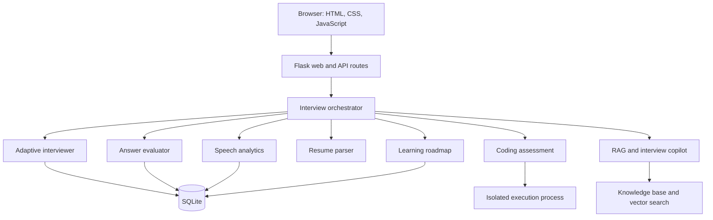

# InterviewIQ
### AI Interview Intelligence Platform

**Practice with purpose. Get evidence-based feedback. Improve with a plan.**

InterviewIQ is a Flask-based mock interview platform that combines adaptive interview flows, explainable answer evaluation, speech analytics, retrieval-augmented feedback, coding assessments, and a personalized learning roadmap.

It is designed to make interview practice more structured: candidates can answer by text or voice, review measurable feedback, and focus their next practice sessions on identified weaknesses.

<p align="center">
  
  
  
  
</p>

---

## At a glance

| Capability | What it does |
|---|---|
| Adaptive interviews | Selects follow-up questions and adjusts difficulty based on submitted answers |
| Explainable evaluation | Scores technical accuracy, relevance, answer quality, and communication with supporting evidence |
| Voice workflow | Transcribes recorded answers with Whisper and extracts delivery metrics |
| RAG knowledge assistant | Retrieves relevant material from a curated knowledge base and returns source-aware responses |
| Resume-aware setup | Extracts skills, projects, and education from an uploaded PDF for interview context |
| Coding assessments | Runs coding problems against visible and hidden tests through a separate execution process |
| Learning roadmap | Builds a personalized 7-day practice plan from detected strengths and weaknesses |

## Product workflow

1. Choose a role, difficulty, and interview length.
2. Start an interview and answer by typing or recording your response.
3. Review the evaluation, including technical, relevance, quality, and communication dimensions.
4. Explore grounded explanations with the post-interview assistant.
5. Practice coding questions and follow the generated learning roadmap.

## System architecture



The routes validate requests and delegate work to services. The orchestrator owns the interview lifecycle and persistence. Optional LLM integrations have non-LLM fallback paths.

For more detail, see [Architecture](docs/ARCHITECTURE.md) and [Viva Notes](docs/VIVA_NOTES.md).

## Technology

- **Language:** Python 3.10+
- **Backend:** Flask
- **Data:** SQLite
- **AI / NLP:** retrieval-augmented generation, embeddings, TF-IDF fallback, optional LLM evaluation
- **Speech:** FFmpeg and optional OpenAI Whisper / faster-whisper
- **Frontend:** HTML, CSS, JavaScript, MediaRecorder, Chart.js
- **Testing:** pytest
- **Execution:** separate-process coding runner; optional Docker sandbox mode

## Run locally

### 1. Clone the repository

```bash
git clone https://github.com/ishika357/interviewiq.git
cd interviewiq
```

### 2. Create and activate a virtual environment

**Windows (PowerShell):**
```powershell
python -m venv venv
.\venv\Scripts\Activate.ps1
```

**macOS / Linux:**
```bash
python3 -m venv venv
source venv/bin/activate
```

### 3. Install dependencies

```bash
pip install -r requirements.txt
```

### 4. Configure environment

Copy the example environment file and adjust values if needed.

**Windows:**
```powershell
Copy-Item .env.example .env
```

**macOS / Linux:**
```bash
cp .env.example .env
```

The application includes fallback behavior and can start without an external LLM API key.

### 5. Start the application

```bash
python app.py
```

Open http://127.0.0.1:5000 in your browser.

## Optional integrations

| Integration | Setup | Fallback |
|---|---|---|
| Voice transcription | Install Whisper or faster-whisper and FFmpeg | Typed answers |
| LLM-based evaluation and generated follow-ups | Configure `OPENAI_API_KEY` or `ANTHROPIC_API_KEY` in `.env` | Rubric and semantic-similarity evaluation |
| Semantic embeddings | Install `sentence-transformers` | TF-IDF |
| Vector indexing | Install `faiss-cpu` | NumPy cosine similarity |
| Containerized code execution | Install Docker and set `SANDBOX_MODE=docker` | Hardened subprocess mode |

Never commit API keys or real candidate data. Keep credentials in your local environment file.

## Run tests

```bash
python -m pytest -q
```

The repository includes tests for evaluation, sandbox behavior, RAG, resume parsing, adaptivity, API flows, and security.

## Engineering decisions

- **Evidence-oriented feedback:** evaluation is structured around explicit scoring dimensions rather than returning only one opaque score.
- **Fallback-first integrations:** core interview flows remain usable when optional model providers or embedding packages are unavailable.
- **Idempotent answer submission:** retries and repeated submissions are handled to avoid accidentally skipping or duplicating an interview question.
- **Source-aware retrieval:** the copilot uses a curated knowledge base and can indicate when relevant material is not found.
- **Privacy-conscious media handling:** audio is transcribed and discarded; camera video is used as a local preview and is not recorded or analyzed.

## Security and limitations

The project includes CSRF protection, password hashing, per-user data access checks, upload validation, security headers, and resource limits for the separate-process coding runner.

**Important:** a Python subprocess is not a complete security boundary. For public deployment, use the Docker sandbox mode with network disabled and appropriate container limits. The Docker mode has not been exercised in the development environment.

Other current limitations:
- Heuristic scoring can under-score answers phrased very differently from curated reference concepts.
- Live external LLM and speech integrations depend on separately installed packages and configured credentials.
- SQLite and in-memory login throttling are suitable for a local project/demo, not a scaled production deployment.
- Browser media behavior should be tested on the target devices and browsers before deployment.

## Project structure

```text
app.py
config.py
db.py
routes/
services/
  orchestrator.py
  interviewer.py
  evaluator.py
  speech.py
  resume.py
  roadmap.py
  coding.py
  sandbox.py
  rag.py
  copilot.py
data/
  knowledge_base/
templates/
static/
docs/
tests/
```

## Roadmap

- [ ] Add deployment configuration and production database support
- [ ] Add integration tests against live model-provider APIs
- [ ] Evaluate scoring quality with a documented benchmark set
- [ ] Expand role-specific knowledge bases and coding assessments
- [ ] Improve observability and production-grade rate limiting

## Author

**Ishika Lakshkar**  
B.Tech Computer Science & Engineering (Artificial Intelligence)

- GitHub: [@ishika357](https://github.com/ishika357)
- LinkedIn: [Ishika Lakshkar](https://www.linkedin.com/in/ishika-lakshkar-a54bba3a1/)

---

<p align="center">
  <sub>Built to make interview preparation more structured, measurable, and actionable.</sub>
</p>
